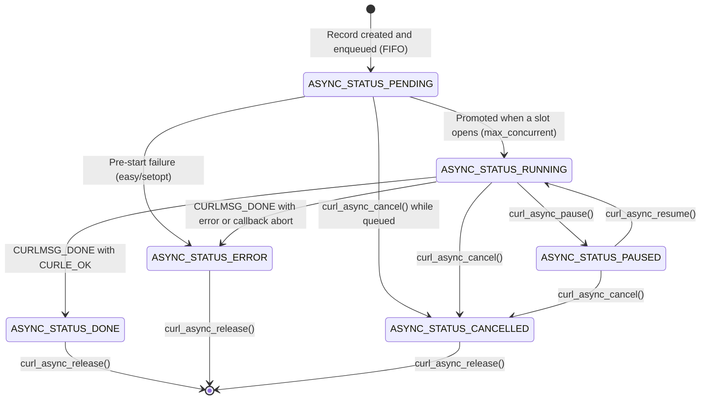

> 🌐 **English** | [Português (BR)](pt-BR/API_ASYNC.md) | [README](../README.md)

# Complete API Reference — `euLibCurlAsync.ew` (Non-Blocking Async Requests & Downloads)

Exhaustive documentation for the non-blocking async sub-library (`include eulibcurl/euLibCurlAsync.ew as async`), covering:
- All **40 public routines** (`namespace curl_async`);
- All **4 public enums** (`ASYNC_STATUS_*`, `INFO_*`, `PROG_*`, `RESP_*`);
- All **31 request option keys** (`opts`), including `form`, callbacks, and network settings;
- Real **FIFO concurrency queue (`max_concurrent`)**, on-demand `output_file` creation, state machine, re-entrancy safety, and practical recipes.

---

## Table of Contents

1. [Importing and Symbol Re-Exports](#1-importing-and-symbol-re-exports)
2. [Lifecycle and States (`ASYNC_STATUS_*`)](#2-lifecycle-and-states-async_status_)
3. [Public Enums & Return Structures](#3-public-enums--return-structures)
4. [Request Options (`opts` — 31 keys)](#4-request-options-opts--31-keys)
5. [Lifecycle Management and Concurrency Queue](#5-lifecycle-management-and-concurrency-queue)
6. [Dispatching Non-Blocking Requests](#6-dispatching-non-blocking-requests)
7. [Pumping and Controlled Waiting](#7-pumping-and-controlled-waiting)
8. [Status, Progress, and Metadata Queries](#8-status-progress-and-metadata-queries)
9. [Reading Results and Transfer Control](#9-reading-results-and-transfer-control)
10. [Cooperative Multitasking (`std/task.e`)](#10-cooperative-multitasking-stdtask_e)
11. [Practical Recipes and Common Pitfalls](#11-practical-recipes-and-common-pitfalls)

---

## 1. Importing and Symbol Re-Exports

```euphoria
include eulibcurl/euLibCurlAsync.ew as async
```

- Defines `namespace curl_async` and publicly includes `euLibCurl.ew` (`public include eulibcurl/euLibCurl.ew as curl`).
- All libcurl constants (e.g., `async:CURLE_OK`, `async:CURLE_CANT_OPEN_FILE`, `async:CURLOPT_BUFFERSIZE`, `async:CURLPROXY_SOCKS5`, `async:CURL_HTTP_VERSION_2TLS`) and core functions are accessible directly through `async:`.
- Built on `curl_multi_perform()` + `curl_multi_info_read()` with native `ASYNCHDNS` (non-blocking DNS resolution in libcurl 8.15.0). No background Euphoria threads are spawned; everything runs safely and cooperatively on the main thread.

---

## 2. Lifecycle and States (`ASYNC_STATUS_*`)



### Status Constants (`ASYNC_STATUS_*`)

| Constant | Value | Meaning |
|---|---|---|
| `ASYNC_STATUS_PENDING` | `1` | Waiting in the FIFO queue for an execution slot (`max_concurrent`). Has **not** opened `output_file`, allocated an easy handle, or started `timeout` / `INFO_ELAPSED` (`0`). |
| `ASYNC_STATUS_RUNNING` | `2` | Actively running in `curl_multi`. |
| `ASYNC_STATUS_PAUSED` | `3` | Receive and send paused via `curl_async_pause()` (still occupies a `max_concurrent` slot). |
| `ASYNC_STATUS_DONE` | `4` | Completed with `CURLE_OK` (`0`). |
| `ASYNC_STATUS_ERROR` | `5` | Failed due to configuration, file open failure, network/DNS/TLS error, timeout, or `on_chunk`/`on_progress` abort. |
| `ASYNC_STATUS_CANCELLED` | `6` | Explicitly cancelled via `curl_async_cancel()` (either while queued or in flight). |

> **Note on HTTP `4xx`/`5xx`:** As in standard libcurl, HTTP `404`/`500` responses complete with `ASYNC_STATUS_DONE` and `INFO_HTTP_CODE = 404` (allowing you to inspect the error response body). To fail automatically on `HTTP >= 400`, pass `{"curl_opts", {{async:CURLOPT_FAILONERROR, 1}}}`.

---

## 3. Public Enums & Return Structures

### 3.1 `INFO_*` — Return of `curl_async_info()` (21 fields)

| Index | Value | Type | Initial / Unavailable | Description |
|---|---|---|---|---|
| `INFO_ID` | `1` | `integer` | `>= 1` | Unique `req_id`. |
| `INFO_STATUS` | `2` | `integer` | `PENDING` or `RUNNING` | Current state (`ASYNC_STATUS_*`). |
| `INFO_METHOD` | `3` | `sequence` | `"GET"`, `"POST"`, etc. | Uppercase HTTP method. |
| `INFO_URL` | `4` | `sequence` | Input URL | Original requested URL. |
| `INFO_EFFECTIVE_URL` | `5` | `sequence` | Same as `URL` | Final effective URL after `3xx` redirects. |
| `INFO_HTTP_CODE` | `6` | `integer` | `0` | HTTP status code (e.g., `200`, `206`, `404`). |
| `INFO_CURL_CODE` | `7` | `integer` | `CURLE_OK (0)` | Final `CURLcode` (or `CURLE_OK` while active). |
| `INFO_ERROR` | `8` | `sequence` | `""` | Detailed error message from `CURLOPT_ERRORBUFFER` or `curl_easy_strerror()`. |
| `INFO_DL_NOW` | `9` | `atom` | `0` | Downloaded body bytes so far. |
| `INFO_DL_TOTAL` | `10` | `atom` | `-1` | Expected total download size (`Content-Length`), or `-1` if unknown. |
| `INFO_DL_PERCENT` | `11` | `atom` | `-1` | Download percentage `0.0 .. 100.0`, or `-1` if total unknown. |
| `INFO_DL_SPEED` | `12` | `atom` | `0` | Download speed in **bytes/second**. |
| `INFO_UL_NOW` | `13` | `atom` | `0` | Uploaded bytes so far. |
| `INFO_UL_TOTAL` | `14` | `atom` | `-1` (or `length(body)`) | Expected total upload size in bytes, or `-1` if unknown. |
| `INFO_UL_PERCENT` | `15` | `atom` | `-1` | Upload percentage `0.0 .. 100.0`, or `-1` if total unknown. |
| `INFO_UL_SPEED` | `16` | `atom` | `0` | Upload speed in **bytes/second**. |
| `INFO_ELAPSED` | `17` | `atom` | `0.0` | Elapsed time in **seconds** (`0` while `PENDING`; `time() - start_time` while `RUNNING`/`PAUSED`; `CURLINFO_TOTAL_TIME` on completion). |
| `INFO_CONTENT_TYPE` | `18` | `sequence` | `""` | Response `Content-Type` header. |
| `INFO_HEADERS` | `19` | `sequence` | `{}` | List of response header strings for the **final** response (resets on redirect status lines). |
| `INFO_OUTPUT_FILE` | `20` | `sequence` | `""` | Destination file path (or `""` when buffering in memory). |
| `INFO_BODY_SIZE` | `21` | `atom` | `0` | Total bytes delivered to `write_cb` (in RAM or on disk). |

### 3.2 `PROG_*` — Return of `curl_async_progress()` and `on_progress` argument (9 fields)

| Index | Value | Type | Description |
|---|---|---|---|
| `PROG_DL_NOW` | `1` | `atom` | Bytes downloaded so far. |
| `PROG_DL_TOTAL` | `2` | `atom` | Expected total download bytes (`-1` if unknown). |
| `PROG_DL_PERCENT` | `3` | `atom` | Download percentage `0.0 .. 100.0` (or `-1`). |
| `PROG_DL_SPEED` | `4` | `atom` | Download speed in bytes/s. |
| `PROG_UL_NOW` | `5` | `atom` | Bytes uploaded so far. |
| `PROG_UL_TOTAL` | `6` | `atom` | Expected total upload bytes (`-1` if unknown). |
| `PROG_UL_PERCENT` | `7` | `atom` | Upload percentage `0.0 .. 100.0` (or `-1`). |
| `PROG_UL_SPEED` | `8` | `atom` | Upload speed in bytes/s. |
| `PROG_ELAPSED` | `9` | `atom` | Elapsed time in seconds. |

### 3.3 `RESP_*` — Return of `curl_async_response()` (6 fields)

| Index | Value | Type | Description |
|---|---|---|---|
| `RESP_STATUS` | `1` | `integer` | Final state (`ASYNC_STATUS_*`). |
| `RESP_CURL_CODE` | `2` | `integer` | `CURLcode` (`0` = success). |
| `RESP_HTTP_CODE` | `3` | `integer` | HTTP status code returned by the server. |
| `RESP_BODY` | `4` | `sequence` | Response body in memory (`""` when `output_file` is used). |
| `RESP_HEADERS` | `5` | `sequence` | List of received HTTP header strings. |
| `RESP_ERROR` | `6` | `sequence` | Descriptive error message (or `""` on success). |

---

## 4. Request Options (`opts` — 31 keys)

`opts_in` accepts a `std/map`, a list of `{{"key", value}, ...}` pairs, or `{}` (default). Options are snapshotted by value upon enqueueing, so reusing the same `std/map` across loop iterations is completely safe.

| Key | Type | Default | Description |
|---|---|---|---|
| `"method"` | `sequence` | `"GET"` | HTTP verb (uppercased). `"HEAD"` sets `CURLOPT_NOBODY = 1`; `"POST"` sets `CURLOPT_POST = 1`; other verbs use `CURLOPT_CUSTOMREQUEST`. |
| `"headers"` | `sequence` | `{}` | List of header strings, e.g., `{"Content-Type: application/json", "Accept: */*"}`. |
| `"body"` | `sequence` | `""` | Raw request payload (binary-safe, sets `CURLOPT_POSTFIELDSIZE_LARGE` + `CURLOPT_POSTFIELDS`). |
| `"form"` | `sequence` | `{}` | Builds a `multipart/form-data` payload via `curl_mime_*` (see formats below). Takes precedence over `"body"`. |
| `"output_file"` | `sequence` | `""` | File path for direct disk streaming (`"wb"`, or `"ab"` with `resume_from > 0`) without buffering in RAM. **On-demand creation:** opened only when the first data chunk arrives, or created empty (0 bytes) if the transfer finishes with `ASYNC_STATUS_DONE` (`CURLE_OK`) and a 0-byte body (except `HEAD`). Pre-data errors (malformed URL, DNS, timeout, TLS, cancellation) **never create or truncate the file**. |
| `"resume_from"` | `atom` | `0` | Starting byte offset (`CURLOPT_RESUME_FROM_LARGE`) to resume a partial download; opens `output_file` in `"ab"` mode when `> 0`. |
| `"follow_redirects"` | `integer` | `1` | Follow `3xx` redirects (`1` = yes, `0` = no). |
| `"max_redirects"` | `integer` | `10` | Maximum redirects when `follow_redirects != 0`. |
| `"timeout"` | `atom` | `0` | Total transfer timeout in **seconds** (fractional supported; converted to `CURLOPT_TIMEOUT_MS`). Does **not** tick while `PENDING` in the FIFO queue. |
| `"connect_timeout"` | `atom` | `0` | Connection timeout in **seconds** (`CURLOPT_CONNECTTIMEOUT_MS`). |
| `"proxy"` | `sequence` | `""` | Proxy address (e.g., `"http://127.0.0.1:8080"`). |
| `"proxy_type"` | `integer` | — | Proxy protocol (`CURLPROXY_HTTP`, `CURLPROXY_HTTPS`, `CURLPROXY_SOCKS4`, `CURLPROXY_SOCKS5`, `CURLPROXY_SOCKS5_HOSTNAME`). |
| `"proxy_userpwd"` | `sequence` | `""` | Proxy credentials `"user:password"`. |
| `"userpwd"` | `sequence` | `""` | HTTP/FTP authentication credentials `"user:password"`. |
| `"user_agent"` | `sequence` | `""` | Custom `User-Agent` header. |
| `"cookie"` | `sequence` | `""` | `Cookie:` header string (e.g., `"sid=abc; theme=dark"`). |
| `"cookie_file"` | `sequence` | `""` | Netscape cookie file path to read (or `""` to enable in-memory cookie engine). |
| `"cookie_jar"` | `sequence` | `""` | File path where cookies are saved upon completion. |
| `"ssl_verify"` | `integer` | `1` | `1` verifies peer and hostname; `0` disables verification. On Windows, applies `CURLSSLOPT_NATIVE_CA` automatically when `ssl_verify = 1` and `ca_info`/`ca_path` are empty. |
| `"ca_info"` | `sequence` | `""` | Path to CA bundle `.pem`/`.crt` (`CURLOPT_CAINFO`). |
| `"ca_path"` | `sequence` | `""` | Path to CA directory (`CURLOPT_CAPATH`). |
| `"accept_encoding"` | `sequence` | `""` | Passed to `CURLOPT_ACCEPT_ENCODING`. Default `""` enables automatic decompression of all supported encodings (`deflate`, `gzip`, `br`, `zstd`). |
| `"max_recv_speed"` | `atom` | `0` | Maximum download speed in **bytes/second** (`CURLOPT_MAX_RECV_SPEED_LARGE`). |
| `"max_send_speed"` | `atom` | `0` | Maximum upload speed in **bytes/second** (`CURLOPT_MAX_SEND_SPEED_LARGE`). |
| `"http_version"` | `integer` | `0` | Desired HTTP version (`CURL_HTTP_VERSION_*`). |
| `"verbose"` | `integer` | `0` | `1` enables verbose libcurl diagnostics on `stderr`. |
| `"curl_opts"` | `sequence` | `{}` | Arbitrary list of `{{CURLOPT_*, value}, ...}` pairs applied to the easy handle. |
| `"on_progress"` | `integer` | `-1` | `routine_id` of `function my_prog(integer req_id, sequence prog)` — return `1` to continue, `0` to abort. |
| `"on_chunk"` | `integer` | `-1` | `routine_id` of `function my_chunk(integer req_id, sequence chunk)` — return `1` to continue, `0` to abort. |
| `"on_complete"` | `integer` | `-1` | `routine_id` of `procedure my_done(integer req_id, integer final_status)` — invoked **after** draining `curl_multi_info_read()` and cleaning up native resources. |
| `"user_data"` | `object` | `0` | Arbitrary Euphoria value attached to `req_id`, retrievable via `curl_async_get_userdata(req_id)`. |

### Supported `"form"` (`multipart/form-data`) Item Formats
1. `{field_name, text_or_bytes}` — simple form field (`curl_mime_data`).
2. `{field_name, disk_file_path, "file"}` — streams a file directly from disk (`curl_mime_filedata`).
3. `{field_name, bytes, remote_filename, mime_type}` — uploads in-memory bytes as a file attachment (3-element items where element 3 is not `"file"` treat element 3 as `remote_filename`).

---

## 5. Lifecycle Management and Concurrency Queue

The library cleanly separates two concurrency layers:

1. **Real FIFO Concurrency Queue (`max_concurrent`):** Limits how many **requests** run simultaneously in `curl_multi` (`RUNNING` + `PAUSED`). When dispatching hundreds of downloads with `max_concurrent = 10`:
   - Only the first **10** enter `curl_multi` (`ASYNC_STATUS_RUNNING`);
   - The rest remain queued in FIFO order in `ASYNC_STATUS_PENDING`;
   - Queued requests do **not** open `output_file`, do **not** allocate C easy handles, and do **not** start `timeout` / `connect_timeout` / `INFO_ELAPSED`;
   - Options are snapshotted by value upon enqueueing;
   - As each transfer finishes or is cancelled, the next queued item is promoted automatically.
2. **libcurl TCP Limits (`max_total_conns`, `max_host_conns`):** Configure `CURLMOPT_MAX_TOTAL_CONNECTIONS` / `CURLMOPT_MAX_HOST_CONNECTIONS`. Under HTTP/2, many streams multiplex over one TCP connection, so always use `max_concurrent` to cap simultaneous downloads.

### `curl_async_init(integer max_total_conns = 0, integer max_host_conns = 0, integer max_concurrent_reqs = -1)` *(procedure)*
Initializes `curl_global_init(CURL_GLOBAL_DEFAULT)`, creates `multi_handle`, and applies optional limits (`max_concurrent_reqs >= 0` sets the FIFO queue cap; `-1` keeps current value, initially `0` = unlimited). Optional — automatically called on the first request if omitted.

### `curl_async_set_limits(integer max_total_conns = 0, integer max_host_conns = 0, integer max_concurrent_reqs = -1)` *(procedure)*
Updates `CURLMOPT_MAX_TOTAL_CONNECTIONS`, `CURLMOPT_MAX_HOST_CONNECTIONS`, and (when `max_concurrent_reqs >= 0`) `curl_async_set_max_concurrent()`.

### `curl_async_set_max_concurrent(integer limit)` *(procedure)*
Sets the FIFO concurrency queue limit (`limit <= 0` means unlimited). Raising the limit immediately promotes queued `PENDING` items; lowering it allows in-flight transfers to finish while pausing new promotions until in-flight count drops below `limit`.

### `curl_async_get_max_concurrent()`
Returns the current concurrency queue limit (`0` = unlimited).

### `curl_async_shutdown()` *(procedure)*
Stops the background cooperative task (if active), closes all open files, cleans up all easy handles/slists/mimes/error buffers, clears pending/deferred queues, resets `max_concurrent = 0`, destroys `multi_handle`, and calls `curl_global_cleanup()`.

---

## 6. Dispatching Non-Blocking Requests

All functions below return an `integer req_id` (`>= 1`) **immediately**.

### `curl_async_request(sequence url, object opts_in = {})`
Core request dispatcher for any HTTP/HTTPS/FTP method configured via `opts_in`.

### `curl_async_get(sequence url, sequence output_file = "", object opts_in = {})`
Shortcut setting `"method" = "GET"` and optionally `"output_file"`.

### `curl_async_download(sequence url, sequence output_file, object opts_in = {})`
Explicit file download shortcut (`"method" = "GET"`, `"output_file" = output_file`).

### `curl_async_post(sequence url, sequence body = "", object opts_in = {})`
Shortcut setting `"method" = "POST"` and `"body" = body` (if not already in `opts_in`).

### `curl_async_put(sequence url, sequence body = "", object opts_in = {})`
Shortcut setting `"method" = "PUT"` and `"body" = body`.

### `curl_async_patch(sequence url, sequence body = "", object opts_in = {})`
Shortcut setting `"method" = "PATCH"` and `"body" = body`.

### `curl_async_delete(sequence url, object opts_in = {})`
Shortcut setting `"method" = "DELETE"`.

### `curl_async_head(sequence url, object opts_in = {})`
Shortcut setting `"method" = "HEAD"` (`CURLOPT_NOBODY = 1`).

---

## 7. Pumping and Controlled Waiting

### `curl_async_poll()`
Promotes queued FIFO items if slots are free, runs `curl_multi_perform()`, drains `curl_multi_info_read()`, finalizes completed transfers, promotes newly eligible queued items, and fires `on_complete` callbacks **outside** `in_poll`. Returns total active requests (`PENDING + RUNNING + PAUSED`). Re-entrancy safe.

### `curl_async_wait_step(integer timeout_ms = 50)`
If transfers are in flight and `timeout_ms > 0`, waits up to `timeout_ms` ms via `curl_multi_poll()` (avoiding busy-wait CPU usage), then calls `curl_async_poll()`. Returns remaining active requests.

### `curl_async_wakeup()`
Calls `curl_multi_wakeup()` to immediately wake a blocked `curl_async_wait_step()`. Returns `CURLMcode`.

### `curl_async_wait(integer req_id, integer timeout_ms = -1, integer poll_interval_ms = 20)`
Waits until `req_id` completes or `timeout_ms` expires (`-1` = no limit), yielding via `task_yield()` each step. Returns final `ASYNC_STATUS_*`.

### `curl_async_wait_all(integer timeout_ms = -1, integer poll_interval_ms = 20)`
Waits until all active requests finish or `timeout_ms` expires. Returns remaining active count (`0` when all complete).

---

## 8. Status, Progress, and Metadata Queries

Functions with `integer auto_poll = 1` automatically pump `curl_async_poll()` before reading state unless `auto_poll = 0` or currently inside `in_poll`.

### `curl_async_status_name(integer status)`
Converts `ASYNC_STATUS_*` into `"PENDING"`, `"RUNNING"`, `"PAUSED"`, `"DONE"`, `"ERROR"`, `"CANCELLED"`, or `"UNKNOWN"`.

### `curl_async_status(integer req_id, integer auto_poll = 1)`
Returns `ASYNC_STATUS_*` for `req_id`, or `0` if non-existent/released.

### `curl_async_is_running(integer req_id, integer auto_poll = 1)`
Returns `1` if `req_id` is `PENDING`, `RUNNING`, or `PAUSED`; otherwise `0`.

### `curl_async_is_done(integer req_id, integer auto_poll = 1)`
Returns `1` if `req_id` is `DONE`, `ERROR`, or `CANCELLED`; otherwise `0`.

### `curl_async_progress(integer req_id, integer auto_poll = 1)`
Refreshes live transfer speeds/elapsed time and returns a 9-element `PROG_*` sequence (or `{}`).

### `curl_async_info(integer req_id, integer auto_poll = 1)`
Refreshes live metadata and returns the 21-element `INFO_*` sequence (or `{}`).

### `curl_async_active_count(integer auto_poll = 1)`
Returns total unfinished requests (`PENDING + RUNNING + PAUSED`). Always equals `curl_async_running_count(0) + curl_async_pending_count(0)`.

### `curl_async_pending_count(integer auto_poll = 1)`
Returns how many requests are currently waiting in the FIFO queue (`ASYNC_STATUS_PENDING`).

### `curl_async_running_count(integer auto_poll = 1)`
Returns how many requests currently occupy a `max_concurrent` slot in `curl_multi` (`RUNNING` or `PAUSED`).

### `curl_async_list(integer active_only = 0)`
Returns a `sequence` of all registered `req_id`s (or only active ones if `active_only != 0`). Does not trigger `auto_poll`.

---

## 9. Reading Results and Transfer Control

### `curl_async_response(integer req_id)`
Returns `{RESP_STATUS, RESP_CURL_CODE, RESP_HTTP_CODE, RESP_BODY, RESP_HEADERS, RESP_ERROR}` (or `{}`).

### `curl_async_body(integer req_id)`
Returns the in-memory response body (`""` when `output_file` was used or `req_id` does not exist).

### `curl_async_headers(integer req_id)`
Returns the list of final response headers (`{}` if unavailable).

### `curl_async_error(integer req_id)`
Returns `{curl_code, error_msg}` (`{CURLE_BAD_FUNCTION_ARGUMENT, "Non-existent req_id"}` if missing).

### `curl_async_get_userdata(integer req_id)`
Returns the `"user_data"` value attached to `req_id` (or `0`).

### `curl_async_pause(integer req_id)`
Pauses an in-flight transfer (`CURLPAUSE_ALL`, status -> `ASYNC_STATUS_PAUSED`, keeping its concurrency slot). Returns `CURLcode` (`CURLE_BAD_CALLING_ORDER` if still `PENDING` or already done).

### `curl_async_resume(integer req_id)`
Resumes a paused transfer (`CURLPAUSE_CONT`, status -> `ASYNC_STATUS_RUNNING`). Returns `CURLcode`.

### `curl_async_cancel(integer req_id)`
Cancels an active request (`PENDING`, `RUNNING`, or `PAUSED`), sets `ASYNC_STATUS_CANCELLED`, and triggers `on_complete`:
- If **`PENDING`**: removes directly from the FIFO queue without ever opening `output_file` or creating an easy handle.
- If **`RUNNING`/`PAUSED`**: closes file, cleans up native handles, and **immediately promotes** the next queued item.
- Safe inside callbacks (`in_poll = 1`). Returns `1` if cancelled, `0` otherwise.

### `curl_async_release(integer req_id)` *(procedure)*
Removes `req_id` from memory (automatically cancelling it first if still active).

---

## 10. Cooperative Multitasking (`std/task.e`)

Available whenever not compiling a DLL (`ifdef not EUC_DLL`).

### `curl_async_start_task(atom min_interval = 0.01, atom max_interval = 0.05)`
Starts a cooperative background task that calls `curl_async_poll()` automatically whenever other tasks call `task_yield()` or `task_delay()`. Returns `atom task_id`.

### `curl_async_stop_task()` *(procedure)*
Suspends and stops the background pumping task.

### `curl_async_task_running()`
Returns `1` if the background task is active and scheduled, `0` otherwise.

---

## 11. Practical Recipes and Common Pitfalls

### Recipe A: Streaming with Early Abort via `on_chunk`
```euphoria
function inspect_chunk(integer req_id, sequence bytes)
    {} = req_id
    if match("FATAL_ERROR", bytes) > 0 then
        return 0 -- Abort download immediately
    end if
    return 1
end function

integer id = async:curl_async_get("https://example.com/stream", "", {
    {"on_chunk", routine_id("inspect_chunk")}
})
```

### Recipe B: Resumable Disk Download (`resume_from`)
```euphoria
include std/filesys.e
sequence dest = "package.zip"
atom already_downloaded = 0
if file_exists(dest) then
    already_downloaded = file_length(dest)
end if

integer id = async:curl_async_download("https://example.com/package.zip", dest, {
    {"resume_from", already_downloaded},
    {"max_recv_speed", 1048576} -- cap at 1 MB/s
})
```

### Recipe C: Batch Downloads with FIFO Queue (`max_concurrent`)
```euphoria
include eulibcurl/euLibCurlAsync.ew as async

procedure on_done(integer req_id, integer final_status)
    sequence inf = async:curl_async_info(req_id, 0)
    printf(1, "[#%d] %s -> %s (HTTP %d)\n", {
        req_id, async:curl_async_status_name(final_status),
        inf[async:INFO_OUTPUT_FILE], inf[async:INFO_HTTP_CODE]
    })
    async:curl_async_release(req_id)
end procedure

async:curl_async_init(0, 0, 10) -- max 10 concurrent downloads

for i = 1 to 300 do
    async:curl_async_download(
        sprintf("https://example.com/files/item_%03d.bin", {i}),
        sprintf("downloads\\item_%03d.bin", {i}),
        {{"timeout", 30}, {"on_complete", routine_id("on_done")}}
    )
end for

while async:curl_async_active_count(0) > 0 do
    async:curl_async_wait_step(50)
end while

async:curl_async_shutdown()
```

### Common Pitfalls
1. **Forgetting `curl_async_release(req_id)`:** Response buffers remain in RAM until released or `curl_async_shutdown()` is called. Release inside `on_complete` for large batches.
2. **Reading `curl_async_body(id)` when using `output_file`:** Disk downloads stream directly to the file, leaving `RESP_BODY = ""`. Check `INFO_DL_NOW` or `INFO_BODY_SIZE` instead.
3. **Not pumping the engine:** Without a hidden C thread, network progress and queue promotion occur whenever you call `curl_async_poll()`, `curl_async_wait_step()`, `curl_async_wait*()`, any query with `auto_poll = 1`, or `task_yield()` (with `curl_async_start_task()`).
4. **Confusing `max_total_conns` with `max_concurrent`:** Use `max_concurrent` to cap simultaneous requests regardless of HTTP/2 connection multiplexing.
5. **When `output_file` is created:** Files are opened lazily upon receiving the first bytes (or created empty on `CURLE_OK` with a 0-byte body, excluding `HEAD`). Pre-data errors never create 0-byte ghost files; mid-transfer failures leave partial bytes on disk for `resume_from`.
