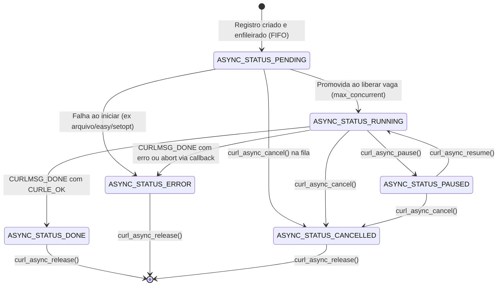

> 🌐 [English](../API_ASYNC.md) | **Português (BR)** | [README](../../README.pt-BR.md)

# Referência Completa — `euLibCurlAsync.ew` (Requisições e Downloads Assíncronos)

Documentação exaustiva da sub-biblioteca assíncrona não-bloqueante (`include eulibcurl/euLibCurlAsync.ew as async`), cobrindo:
- Todas as **40 rotinas públicas** (`namespace curl_async`);
- Todos os **4 enums públicos expostos** (`ASYNC_STATUS_*`, `INFO_*`, `PROG_*`, `RESP_*`);
- Todas as **31 chaves de configuração** aceitas em `opts` (incluindo `form`, callbacks e opções de rede);
- Fila real de concorrência FIFO (`max_concurrent`), ciclo de estados, reentrância e receitas práticas de uso sem travar a execução do script.

---

## Sumário

1. [Importação e Re-exportação de Símbolos](#1-importação-e-re-exportação-de-símbolos)
2. [Ciclo de Vida e Estados (`ASYNC_STATUS_*`)](#2-ciclo-de-vida-e-estados-async_status_)
3. [Estruturas e Enums Públicos Expostos](#3-estruturas-e-enums-públicos-expostos)
4. [Opções de Requisição (`opts` — 31 chaves)](#4-opções-de-requisição-opts--31-chaves)
5. [Gerenciamento do Ciclo de Vida e Fila de Concorrência](#5-gerenciamento-do-ciclo-de-vida-e-fila-de-concorrência)
6. [Envio de Requisições Não-Bloqueantes](#6-envio-de-requisições-não-bloqueantes)
7. [Bombeamento e Espera Controlada](#7-bombeamento-e-espera-controlada)
8. [Consulta de Status, Progresso e Metadados](#8-consulta-de-status-progresso-e-metadados)
9. [Leitura de Resultados e Controle da Transferência](#9-leitura-de-resultados-e-controle-da-transferência)
10. [Multitarefa Cooperativa (`std/task.e`)](#10-multitarefa-cooperativa-stdtask_e)
11. [Receitas Práticas e Armadilhas](#11-receitas-práticas-e-armadilhas)

---

## 1. Importação e Re-exportação de Símbolos

```euphoria
include eulibcurl/euLibCurlAsync.ew as async
```

- O módulo define `namespace curl_async` e inclui `public include eulibcurl/euLibCurl.ew as curl`.
- Por conta do `public include`, **todas as constantes da libcurl** (ex: `async:CURLE_OK`, `async:CURLE_CANT_OPEN_FILE`, `async:CURLOPT_BUFFERSIZE`, `async:CURLPROXY_SOCKS5`, `async:CURL_HTTP_VERSION_2TLS`) e funções públicas de `euLibCurl.ew` ficam acessíveis também pelo namespace `async:`.
- Internamente, usa `curl_multi_perform()` + `curl_multi_info_read()` com `ASYNCHDNS` (resolução DNS não-bloqueante nativa na `libcurl 8.15.0`). Nenhuma requisição dispara threads separadas do Euphoria; tudo roda de forma cooperativa e segura no processo principal.

---

## 2. Ciclo de Vida e Estados (`ASYNC_STATUS_*`)



### Constantes de Estado (`ASYNC_STATUS_*`)

| Constante | Valor | Significado |
|---|---|---|
| `ASYNC_STATUS_PENDING` | `1` | Na fila FIFO aguardando vaga de execução (`max_concurrent`). Ainda **não** abriu `output_file`, **não** alocou easy handle e **não** iniciou a contagem de `timeout` nem de `INFO_ELAPSED` (`0`). |
| `ASYNC_STATUS_RUNNING` | `2` | Transferência ativa em andamento no motor `curl_multi`. |
| `ASYNC_STATUS_PAUSED` | `3` | Recebimento e envio pausados via `curl_async_pause()` (continua ocupando uma vaga em `max_concurrent`). |
| `ASYNC_STATUS_DONE` | `4` | Transferência concluída com `CURLE_OK` (`0`). |
| `ASYNC_STATUS_ERROR` | `5` | Falha na configuração, abertura do arquivo de saída, rede, timeout ou abortamento via `on_chunk`/`on_progress`. |
| `ASYNC_STATUS_CANCELLED` | `6` | Cancelada explicitamente por `curl_async_cancel()` (seja na fila ou em execução). |

> **Nota sobre HTTP `4xx`/`5xx`:** Assim como na libcurl padrão, respostas HTTP `404` ou `500` concluem normalmente com `ASYNC_STATUS_DONE` e `INFO_HTTP_CODE = 404` (ou `500`), permitindo ler o corpo da resposta de erro. Se quiser tratar `HTTP >= 400` como erro da libcurl (`CURLE_HTTP_RETURNED_ERROR`), passe `{"curl_opts", {{async:CURLOPT_FAILONERROR, 1}}}`.

---

## 3. Estruturas e Enums Públicos Expostos

### 3.1 `INFO_*` — Retorno de `curl_async_info()` (21 campos)

| Índice | Valor | Tipo | Valor Inicial / Indisponível | Descrição |
|---|---|---|---|---|
| `INFO_ID` | `1` | `integer` | `>= 1` | Identificador único `req_id` da requisição. |
| `INFO_STATUS` | `2` | `integer` | `ASYNC_STATUS_PENDING` ou `RUNNING` | Estado atual (`ASYNC_STATUS_*`). |
| `INFO_METHOD` | `3` | `sequence` | `"GET"`, `"POST"`, etc. | Método HTTP em maiúsculas. |
| `INFO_URL` | `4` | `sequence` | URL passada | URL original informada no disparo. |
| `INFO_EFFECTIVE_URL` | `5` | `sequence` | Igual a `URL` | URL final efetiva após redirecionamentos (`3xx`). |
| `INFO_HTTP_CODE` | `6` | `integer` | `0` | Código HTTP da resposta (ex: `200`, `206`, `404`). |
| `INFO_CURL_CODE` | `7` | `integer` | `CURLE_OK (0)` | Código `CURLcode` final (ou `CURLE_OK` enquanto ativa). |
| `INFO_ERROR` | `8` | `sequence` | `""` | Mensagem detalhada do `CURLOPT_ERRORBUFFER` ou `curl_easy_strerror()`. |
| `INFO_DL_NOW` | `9` | `atom` | `0` | Total de bytes recebidos (corpo) até o momento. |
| `INFO_DL_TOTAL` | `10` | `atom` | `-1` | Tamanho total esperado em bytes (do `Content-Length`), ou `-1` se desconhecido; ao finalizar com `DONE` sem `Content-Length` mas com dados recebidos, iguala `DL_NOW`. |
| `INFO_DL_PERCENT` | `11` | `atom` | `-1` | Percentual de download `0.0 .. 100.0`, ou `-1` quando `DL_TOTAL <= 0`. |
| `INFO_DL_SPEED` | `12` | `atom` | `0` | Velocidade de download em **bytes/segundo** (da libcurl ou estimada por `DL_NOW / ELAPSED`). |
| `INFO_UL_NOW` | `13` | `atom` | `0` | Total de bytes enviados até o momento. |
| `INFO_UL_TOTAL` | `14` | `atom` | `-1` (ou `length(body)`) | Tamanho total de upload em bytes, ou `-1` se desconhecido. |
| `INFO_UL_PERCENT` | `15` | `atom` | `-1` | Percentual de upload `0.0 .. 100.0`, ou `-1` quando `UL_TOTAL <= 0`. |
| `INFO_UL_SPEED` | `16` | `atom` | `0` | Velocidade de upload em **bytes/segundo**. |
| `INFO_ELAPSED` | `17` | `atom` | `0.0` | Tempo decorrido em **segundos** (`0` enquanto `PENDING`; `time() - start_time` durante `RUNNING`/`PAUSED`; `CURLINFO_TOTAL_TIME` ao finalizar). |
| `INFO_CONTENT_TYPE` | `18` | `sequence` | `""` | Header `Content-Type` informado pela resposta. |
| `INFO_HEADERS` | `19` | `sequence` | `{}` | Lista de strings com os cabeçalhos da resposta **final** (reinicia ao detectar novo status `"HTTP/"` após redirect). |
| `INFO_OUTPUT_FILE` | `20` | `sequence` | `""` | Caminho do arquivo de saída (ou `""` se armazenando em memória). |
| `INFO_BODY_SIZE` | `21` | `atom` | `0` | Quantidade acumulada de bytes entregues ao `write_cb` (em RAM ou gravados em disco). |

### 3.2 `PROG_*` — Retorno de `curl_async_progress()` e argumento de `on_progress` (9 campos)

| Índice | Valor | Tipo | Descrição |
|---|---|---|---|
| `PROG_DL_NOW` | `1` | `atom` | Bytes baixados até o momento. |
| `PROG_DL_TOTAL` | `2` | `atom` | Total esperado para download (`-1` se desconhecido). |
| `PROG_DL_PERCENT` | `3` | `atom` | Percentual `0.0 .. 100.0` (ou `-1` se total desconhecido). |
| `PROG_DL_SPEED` | `4` | `atom` | Velocidade de download em bytes/s. |
| `PROG_UL_NOW` | `5` | `atom` | Bytes enviados até o momento. |
| `PROG_UL_TOTAL` | `6` | `atom` | Total esperado para upload (`-1` se desconhecido). |
| `PROG_UL_PERCENT` | `7` | `atom` | Percentual de upload `0.0 .. 100.0` (ou `-1` se total desconhecido). |
| `PROG_UL_SPEED` | `8` | `atom` | Velocidade de upload em bytes/s. |
| `PROG_ELAPSED` | `9` | `atom` | Tempo decorrido em segundos. |

### 3.3 `RESP_*` — Retorno de `curl_async_response()` (6 campos)

| Índice | Valor | Tipo | Descrição |
|---|---|---|---|
| `RESP_STATUS` | `1` | `integer` | Estado final (`ASYNC_STATUS_*`). |
| `RESP_CURL_CODE` | `2` | `integer` | Código `CURLcode` (`0` = sucesso). |
| `RESP_HTTP_CODE` | `3` | `integer` | Código HTTP retornado pelo servidor (ex: `200`). |
| `RESP_BODY` | `4` | `sequence` | Corpo recebido em memória (`""` quando `output_file` foi usado!). |
| `RESP_HEADERS` | `5` | `sequence` | Lista de strings com os cabeçalhos HTTP recebidos. |
| `RESP_ERROR` | `6` | `sequence` | Mensagem de erro descritiva (ou `""` se não houve erro). |

---

## 4. Opções de Requisição (`opts` — 31 chaves)

O parâmetro `opts_in` aceita um `map:map`, uma lista de pares `{ {"chave", valor}, ... }`, ou `{}` (padrão).

| Chave | Tipo | Padrão | Descrição / Observações |
|---|---|---|---|
| `"method"` | `sequence` | `"GET"` | Verbo HTTP (convertido para maiúsculas). `"HEAD"` ativa `CURLOPT_NOBODY = 1`; `"POST"` ativa `CURLOPT_POST = 1`; outros verbos usam `CURLOPT_CUSTOMREQUEST`. |
| `"headers"` | `sequence` | `{}` | Lista de strings de cabeçalho, ex: `{"Content-Type: application/json", "Accept: */*"}`. |
| `"body"` | `sequence` | `""` | Payload bruto (JSON, form-urlencoded, binário com `\0`, etc.). Define `CURLOPT_POSTFIELDSIZE_LARGE` + `CURLOPT_POSTFIELDS`. |
| `"form"` | `sequence` | `{}` | Monta payload `multipart/form-data` via `curl_mime_*` (ver formatos abaixo). Ignora `"body"` se preenchido. |
| `"output_file"` | `sequence` | `""` | Caminho de arquivo para streaming direto em disco (`"wb"` ou `"ab"` com `resume_from > 0`), sem acumular o corpo em memória. **Abertura sob demanda:** o arquivo só é criado/aberto ao receber o 1º chunk de dados, ou criado vazio (0 bytes) se a requisição concluir com `ASYNC_STATUS_DONE` (`CURLE_OK`) e corpo vazio (exceto `HEAD`). Em erros antes do 1º byte (URL inválida, DNS, timeout, TLS, cancelamento prévio), **nenhum arquivo é criado nem sobrescrito**. |
| `"resume_from"` | `atom` | `0` | Offset inicial em bytes (`CURLOPT_RESUME_FROM_LARGE`) para retomar download parcial. Quando `> 0`, abre `output_file` em modo append (`"ab"`). |
| `"follow_redirects"` | `integer` | `1` | Segue redirecionamentos HTTP `3xx` (`1` = sim, `0` = não). |
| `"max_redirects"` | `integer` | `10` | Limite máximo de redirecionamentos quando `follow_redirects != 0`. |
| `"timeout"` | `atom` | `0` | Tempo máximo total da transferência em **segundos** (aceita frações, convertido para `CURLOPT_TIMEOUT_MS`). |
| `"connect_timeout"` | `atom` | `0` | Tempo máximo para conexão TCP/TLS em **segundos** (convertido para `CURLOPT_CONNECTTIMEOUT_MS`). |
| `"proxy"` | `sequence` | `""` | Endereço do proxy (ex: `"http://127.0.0.1:8080"` ou `"127.0.0.1:1080"`). |
| `"proxy_type"` | `integer` | — | Tipo do proxy: `CURLPROXY_HTTP`, `CURLPROXY_HTTPS`, `CURLPROXY_SOCKS4`, `CURLPROXY_SOCKS5`, `CURLPROXY_SOCKS5_HOSTNAME`, etc. |
| `"proxy_userpwd"` | `sequence` | `""` | Credenciais do proxy no formato `"usuario:senha"`. |
| `"userpwd"` | `sequence` | `""` | Credenciais de autenticação HTTP/FTP no formato `"usuario:senha"`. |
| `"user_agent"` | `sequence` | `""` | Valor do cabeçalho `User-Agent`. |
| `"cookie"` | `sequence` | `""` | String de cookies enviada no header `Cookie:` (ex: `"sid=abc; theme=dark"`). |
| `"cookie_file"` | `sequence` | `""` | Caminho de arquivo Netscape/cookie-jar para leitura inicial de cookies (ou `""` para ativar cookie engine em memória). |
| `"cookie_jar"` | `sequence` | `""` | Caminho de arquivo onde salvar cookies ao finalizar o handle. |
| `"ssl_verify"` | `integer` | `1` | `1` verifica certificado e hostname (`VERIFYPEER=1`, `VERIFYHOST=2`); `0` desativa verificação TLS (`0`, `0`). No Windows, se `ssl_verify = 1` e `ca_info`/`ca_path` estiverem vazios, aplica `CURLSSLOPT_NATIVE_CA` automaticamente. |
| `"ca_info"` | `sequence` | `""` | Caminho para arquivo `.pem`/`.crt` de Autoridades Certificadoras confiáveis (`CURLOPT_CAINFO`). |
| `"ca_path"` | `sequence` | `""` | Diretório com certificados CA (`CURLOPT_CAPATH`). |
| `"accept_encoding"` | `sequence` | `""` | String passada a `CURLOPT_ACCEPT_ENCODING`. Padrão `""` habilita descompressão automática de todas as codificações suportadas (`deflate`, `gzip`, `br`, `zstd`). |
| `"max_recv_speed"` | `atom` | `0` | Limite máximo de download em **bytes/segundo** (`CURLOPT_MAX_RECV_SPEED_LARGE`). |
| `"max_send_speed"` | `atom` | `0` | Limite máximo de upload em **bytes/segundo** (`CURLOPT_MAX_SEND_SPEED_LARGE`). |
| `"http_version"` | `integer` | `0` | Versão HTTP desejada (`CURL_HTTP_VERSION_NONE`, `1_0`, `1_1`, `2_0`, `2TLS`, `3`, `3ONLY`). |
| `"verbose"` | `integer` | `0` | `1` ativa saída detalhada de diagnóstico da libcurl no `stderr`. |
| `"curl_opts"` | `sequence` | `{}` | Lista de pares `{{CURLOPT_*, valor}, ...}` aplicados ao easy handle antes do disparo (permite usar qualquer opção avançada da libcurl). |
| `"on_progress"` | `integer` | `-1` | `routine_id` de callback chamado durante a transferência (`function my_prog(integer req_id, sequence prog)` — retorne `1` para continuar ou `0` para abortar). |
| `"on_chunk"` | `integer` | `-1` | `routine_id` de callback chamado a cada bloco de bytes recebido (`function my_chunk(integer req_id, sequence chunk)` — retorne `1` para continuar ou `0` para abortar). |
| `"on_complete"` | `integer` | `-1` | `routine_id` de callback chamado quando a requisição finaliza (`procedure my_done(integer req_id, integer final_status)`). Executado **após** drenar `curl_multi_info_read()` e limpar recursos nativos. |
| `"user_data"` | `object` | `0` | Qualquer valor Euphoria associado ao `req_id` e recuperável via `curl_async_get_userdata(req_id)`. |

### Formatos suportados dentro de `"form"` (`multipart/form-data`)
Cada item da lista `"form"` pode ter uma das três formas:
1. `{nome_campo, valor_texto_ou_bytes}` — campo de formulário simples (`curl_mime_data`).
2. `{nome_campo, caminho_arquivo, "file"}` — envia arquivo direto do disco (`curl_mime_filedata`).
3. `{nome_campo, dados_bytes, nome_arquivo_remoto, mime_type}` — envia bytes já em memória como anexo de arquivo (`curl_mime_data` + `curl_mime_filename` + `curl_mime_type`; `nome_arquivo_remoto` ou `mime_type` podem ser `""` se omitidos). Se um item tiver 3 elementos onde o 3º não for `"file"`, o 3º é tratado como `nome_arquivo_remoto`.

---

## 5. Gerenciamento do Ciclo de Vida e Fila de Concorrência

A biblioteca separa claramente dois níveis de controle:

1. **Fila real de concorrência (`max_concurrent`):** Controla quantas **requisições** podem estar em execução simultânea no motor `curl_multi` (incluindo `RUNNING` e `PAUSED`). Quando você dispara centenas de downloads com `max_concurrent = 10`:
   - Apenas os **10 primeiros** entram no `curl_multi` (`ASYNC_STATUS_RUNNING`);
   - Os restantes ficam na fila FIFO interna em `ASYNC_STATUS_PENDING`;
   - Requisições em `PENDING` **não** abrem `output_file` (evitando estourar o limite de descritores de arquivo do Windows CRT, ~512), **não** alocam easy handle C e **não** iniciam a contagem de `timeout` / `connect_timeout` / `INFO_ELAPSED`;
   - As opções `opts` são copiadas por valor ao enfileirar (reutilizar o mesmo `std/map` em um `for` é 100% seguro);
   - À medida que cada transferência conclui (ou é cancelada), a próxima da fila FIFO é promovida automaticamente.
2. **Limites TCP do `curl_multi` (`max_total_conns`, `max_host_conns`):** Controlam conexões de rede no nível da libcurl (`CURLMOPT_MAX_TOTAL_CONNECTIONS` / `CURLMOPT_MAX_HOST_CONNECTIONS`). Em HTTP/2, várias requisições podem multiplexar sobre a mesma conexão TCP; por isso, para limitar quantos downloads rodam em paralelo, use sempre `max_concurrent`.

### `curl_async_init(integer max_total_conns = 0, integer max_host_conns = 0, integer max_concurrent_reqs = -1)` *(procedure)*
- Inicializa `curl_global_init(CURL_GLOBAL_DEFAULT)`, cria o `multi_handle` e aplica os limites opcionais.
- `max_total_conns` / `max_host_conns`: limites TCP no `curl_multi` (`0` = padrão sem limite).
- `max_concurrent_reqs`: limite máximo de requisições simultâneas na fila FIFO (`0` = ilimitado; `> 0` = no máximo N simultâneas; `-1` = mantém o valor atual, que inicia em `0`).
- Se já estiver inicializado, apenas atualiza os limites chamando `curl_async_set_limits()`.
- **Nota:** É opcional — a primeira chamada a `curl_async_request()` chama `curl_async_init()` automaticamente caso ainda não tenha sido inicializado.

### `curl_async_set_limits(integer max_total_conns = 0, integer max_host_conns = 0, integer max_concurrent_reqs = -1)` *(procedure)*
- Configura `CURLMOPT_MAX_TOTAL_CONNECTIONS` (se `max_total_conns > 0`), `CURLMOPT_MAX_HOST_CONNECTIONS` (se `max_host_conns > 0`) no `multi_handle` ativo e, se `max_concurrent_reqs >= 0`, chama `curl_async_set_max_concurrent(max_concurrent_reqs)`.

### `curl_async_set_max_concurrent(integer limit)` *(procedure)*
- Define o limite máximo de requisições executando simultaneamente no `curl_multi`.
- `limit <= 0` remove o limite (ilimitado; todas as pendentes entram imediatamente).
- Pode ser chamada **antes** ou **durante** a execução:
  - Ao **aumentar** o limite (ou mudar para `0`), itens na fila `PENDING` são promovidos imediatamente para preencher as novas vagas.
  - Ao **reduzir** o limite, as requisições já em voo concluem normalmente; novas promoções só ocorrem quando o total em execução cair abaixo do novo limite.

### `curl_async_get_max_concurrent()`
- Retorna o limite atual de concorrência da fila (`integer`; `0` = ilimitado).

### `curl_async_shutdown()` *(procedure)*
- Encerra a tarefa cooperativa de fundo (se ativa), fecha todos os arquivos em disco abertos, remove/limpa todos os easy handles, `slist`, `mime` e buffers de erro, esvazia a fila pendente e callbacks adiados, restaura `max_concurrent = 0`, limpa os mapas internos, destrói `multi_handle` e chama `curl_global_cleanup()`.

---

## 6. Envio de Requisições Não-Bloqueantes

Todas as rotinas abaixo retornam **imediatamente** um `integer req_id` (`>= 1`). Se houver vaga de concorrência (`max_concurrent = 0` ou `em_execucao < max_concurrent`), a requisição inicia a resolução DNS / conexão TCP imediatamente sem bloquear; caso contrário, permanece na fila FIFO em `ASYNC_STATUS_PENDING` até liberar vaga. Se ocorrer falha ao iniciar (ex: arquivo `output_file` inacessível ou erro no `setopt`), o `req_id` é marcado com `ASYNC_STATUS_ERROR` e dispara `on_complete` (se configurado), sem travar o restante da fila.

### `curl_async_request(sequence url, object opts_in = {})`
- Função principal que configura e dispara qualquer requisição HTTP/HTTPS/FTP/etc. conforme `opts_in`. Retorna `integer req_id`.

### `curl_async_get(sequence url, sequence output_file = "", object opts_in = {})`
- Atalho que força `"method" = "GET"` e, se `length(output_file) > 0`, define `"output_file"`. Retorna `integer req_id`.

### `curl_async_download(sequence url, sequence output_file, object opts_in = {})`
- Atalho explícito para download em arquivo (`"method" = "GET"` e `"output_file" = output_file`). Retorna `integer req_id`.

### `curl_async_post(sequence url, sequence body = "", object opts_in = {})`
- Atalho que força `"method" = "POST"` e define `"body" = body` (caso `"body"` ainda não esteja em `opts_in`). Retorna `integer req_id`.

### `curl_async_put(sequence url, sequence body = "", object opts_in = {})`
- Atalho que força `"method" = "PUT"` e define `"body" = body` (caso ausente em `opts_in`). Retorna `integer req_id`.

### `curl_async_patch(sequence url, sequence body = "", object opts_in = {})`
- Atalho que força `"method" = "PATCH"` e define `"body" = body` (caso ausente em `opts_in`). Retorna `integer req_id`.

### `curl_async_delete(sequence url, object opts_in = {})`
- Atalho que força `"method" = "DELETE"`. Retorna `integer req_id`.

### `curl_async_head(sequence url, object opts_in = {})`
- Atalho que força `"method" = "HEAD"` (`CURLOPT_NOBODY = 1`). Retorna `integer req_id` (sem corpo, apenas cabeçalhos e `HTTP_CODE`).

---

## 7. Bombeamento e Espera Controlada

### `curl_async_poll()`
- Promove itens da fila FIFO caso existam vagas livres, executa `curl_multi_perform()`, lê todas as mensagens `CURLMSG_DONE` via `curl_multi_info_read()`, coleta metadados finais (`curl_easy_getinfo` + `errbuf`), fecha arquivos, limpa recursos nativos, promove imediatamente os próximos itens da fila para as vagas recém-liberadas e dispara callbacks `on_complete` **após** encerrar a seção crítica `in_poll`.
- **Retorno:** `integer` — quantidade total de requisições ainda ativas (`PENDING` + `RUNNING` + `PAUSED`).
- **Segurança:** Se chamado recursivamente quando `in_poll = 1` (de dentro de `on_progress`/`on_chunk`), retorna imediatamente `count_active_requests()` sem chamar `curl_multi_perform`.

### `curl_async_wait_step(integer timeout_ms = 50)`
- Se houver requisições em execução no `curl_multi` e `timeout_ms > 0`, aguarda até `timeout_ms` ms por atividade nos sockets (via `curl_multi_poll`, economizando CPU em loops) e em seguida executa `curl_async_poll()`. Se houver apenas itens `PENDING` aguardando promoção, pula a espera e promove imediatamente.
- **Retorno:** `integer` — requisições ativas restantes (`PENDING` + `RUNNING` + `PAUSED`).

### `curl_async_wakeup()`
- Chama `curl_multi_wakeup()` para acordar imediatamente uma chamada em andamento em `curl_async_wait_step()`. Retorna `CURLMcode` (`CURLM_BAD_HANDLE` se não inicializado).

### `curl_async_wait(integer req_id, integer timeout_ms = -1, integer poll_interval_ms = 20)`
- Bloqueia de maneira controlada até que `req_id` deixe de estar rodando ou atinja `timeout_ms` ms (`-1` = espera sem limite), chamando `curl_async_wait_step()` e `task_yield()` em cada ciclo.
- **Retorno:** `integer` — estado atual (`ASYNC_STATUS_*`) ao sair.

### `curl_async_wait_all(integer timeout_ms = -1, integer poll_interval_ms = 20)`
- Aguarda todas as requisições ativas até concluírem ou atingir `timeout_ms` ms (`-1` = sem limite).
- **Retorno:** `integer` — quantidade de requisições ainda ativas ao terminar (`0` se todas concluíram).

---

## 8. Consulta de Status, Progresso e Metadados

Todas as funções desta seção com parâmetro `integer auto_poll = 1` executam `curl_async_poll()` automaticamente antes de ler o estado (a menos que `auto_poll = 0` ou que já estejamos dentro de um callback com `in_poll = 1`).

### `curl_async_status_name(integer status)`
- Converte um código `ASYNC_STATUS_*` em string legível: `"PENDING"`, `"RUNNING"`, `"PAUSED"`, `"DONE"`, `"ERROR"`, `"CANCELLED"` ou `"UNKNOWN"`.

### `curl_async_status(integer req_id, integer auto_poll = 1)`
- Retorna o estado atual (`ASYNC_STATUS_*`) de `req_id`, ou `0` se `req_id` não existir (ou já tiver sido liberado com `curl_async_release`).

### `curl_async_is_running(integer req_id, integer auto_poll = 1)`
- Retorna `1` se `req_id` está `PENDING`, `RUNNING` ou `PAUSED`; caso contrário retorna `0`.

### `curl_async_is_done(integer req_id, integer auto_poll = 1)`
- Retorna `1` se `req_id` terminou (`DONE`, `ERROR` ou `CANCELLED`); caso contrário retorna `0`.

### `curl_async_progress(integer req_id, integer auto_poll = 1)`
- Atualiza informações ao vivo do easy handle (velocidades instantâneas, tempo decorrido) e retorna uma `sequence` de 9 elementos indexada por `PROG_*` (ver [seção 3.2](#32-prog_--retorno-de-curl_async_progress-e-argumento-de-on_progress-9-campos)), ou `{}` se `req_id` for inválido.

### `curl_async_info(integer req_id, integer auto_poll = 1)`
- Atualiza informações ao vivo do easy handle e retorna o registro completo de 21 elementos indexado por `INFO_*` (ver [seção 3.1](#31-info_--retorno-de-curl_async_info-21-campos)), ou `{}` se `req_id` for inválido.

### `curl_async_active_count(integer auto_poll = 1)`
- Retorna quantas requisições estão atualmente ativas no total (`PENDING` + `RUNNING` + `PAUSED`). É sempre igual a `curl_async_running_count(0) + curl_async_pending_count(0)`.

### `curl_async_pending_count(integer auto_poll = 1)`
- Retorna quantas requisições estão aguardando vaga na fila FIFO (`ASYNC_STATUS_PENDING`).

### `curl_async_running_count(integer auto_poll = 1)`
- Retorna quantas requisições estão atualmente ocupando vaga de execução no `curl_multi` (`ASYNC_STATUS_RUNNING` ou `ASYNC_STATUS_PAUSED`).

### `curl_async_list(integer active_only = 0)`
- Retorna uma `sequence` com todos os `req_id` registrados no gerenciador (ou apenas os ativos se `active_only != 0`). Não dispara `auto_poll`.

---

## 9. Leitura de Resultados e Controle da Transferência

### `curl_async_response(integer req_id)`
- Retorna `{RESP_STATUS, RESP_CURL_CODE, RESP_HTTP_CODE, RESP_BODY, RESP_HEADERS, RESP_ERROR}` (ver [seção 3.3](#33-resp_--retorno-de-curl_async_response-6-campos)), ou `{}` se `req_id` não existir.

### `curl_async_body(integer req_id)`
- Retorna a `sequence` com o corpo acumulado em memória (`""` se usou `output_file` ou se `req_id` não existir).

### `curl_async_headers(integer req_id)`
- Retorna uma `sequence` de strings com os cabeçalhos HTTP da resposta final (`{}` se indisponível).

### `curl_async_error(integer req_id)`
- Retorna `{curl_code, error_msg}`. Para `req_id` inexistente retorna `{CURLE_BAD_FUNCTION_ARGUMENT, "req_id inexistente"}`.

### `curl_async_get_userdata(integer req_id)`
- Retorna o objeto passado na opção `"user_data"` ao criar `req_id` (ou `0` se não informado/inexistente).

### `curl_async_pause(integer req_id)`
- Pausa a transferência usando `curl_easy_pause(eh, CURLPAUSE_ALL)` e muda o estado para `ASYNC_STATUS_PAUSED` (mantendo a vaga em `max_concurrent`). Retorna `CURLE_OK` em sucesso (`CURLE_BAD_FUNCTION_ARGUMENT` se `req_id` não existir, `CURLE_BAD_CALLING_ORDER` se ainda estiver `PENDING` ou já finalizada).

### `curl_async_resume(integer req_id)`
- Retoma a transferência usando `curl_easy_pause(eh, CURLPAUSE_CONT)`, restaura `ASYNC_STATUS_RUNNING` e aciona `auto_poll`. Retorna `CURLcode`.

### `curl_async_cancel(integer req_id)`
- Cancela uma transferência ativa (`PENDING`, `RUNNING` ou `PAUSED`), definindo status `ASYNC_STATUS_CANCELLED` e disparando `on_complete` (se configurado):
  - Se ainda estava **`PENDING` na fila**: remove diretamente da fila FIFO sem jamais abrir `output_file` nem criar easy handle;
  - Se estava **`RUNNING`/`PAUSED`**: fecha arquivo, limpa handles nativos e **promove imediatamente** o próximo item da fila `PENDING` para a vaga liberada.
- **Comportamento seguro em callbacks:** Se chamado enquanto `in_poll = 1` (dentro de `on_progress`/`on_chunk`), itens `PENDING` são removidos da fila na hora (com `on_complete` adiado para o fim do `poll`), enquanto itens `RUNNING` têm apenas suas flags de cancelamento sinalizadas para finalização segura fora de `curl_multi_perform`.
- **Retorno:** `1` se cancelou; `0` se `req_id` não existia ou já estava finalizado.

### `curl_async_release(integer req_id)` *(procedure)*
- Remove o registro `req_id` do mapa em memória (liberando o `body` armazenado). Se a requisição ainda estiver ativa, chama `curl_async_cancel(req_id)` automaticamente antes de remover.

---

## 10. Multitarefa Cooperativa (`std/task.e`)

Disponível sempre que não estiver compilando uma DLL (`ifdef not EUC_DLL`).

### `curl_async_start_task(atom min_interval = 0.01, atom max_interval = 0.05)`
- Inicializa `euLibCurlAsync` se necessário, cria e agenda uma tarefa de tempo real cooperativa (`task_schedule(..., {min_interval, max_interval})`) que chama `curl_async_poll()` continuamente sempre que outras tasks chamarem `task_yield()` ou `task_delay()`.
- **Retorno:** `atom` — o `task_id` da tarefa agendada.

### `curl_async_stop_task()` *(procedure)*
- Sinaliza encerramento do loop e suspende a tarefa cooperativa de fundo.

### `curl_async_task_running()`
- Retorna `1` se a tarefa de fundo estiver ativa e escalonada (`task_status(bg_task_id) > 0`), ou `0` caso contrário.

---

## 11. Receitas Práticas e Armadilhas

### Receita A: Streaming via `on_chunk` com abortamento antecipado
```euphoria
function meu_chunk(integer req_id, sequence bytes)
    -- Processa ou inspeciona cada bloco recebido em tempo real
    if match("ERRO_FATAL", bytes) > 0 then
        return 0 -- Aborta o download imediatamente!
    end if
    return 1 -- Continua normalmente
end function

integer id = async:curl_async_get("https://exemplo.com/stream", "", {
    {"on_chunk", routine_id("meu_chunk")}
})
```
*Nota:* Quando `on_chunk` ou `on_progress` retorna `0`, a requisição finaliza com `ASYNC_STATUS_ERROR` (`CURLE_WRITE_ERROR` ou `CURLE_ABORTED_BY_CALLBACK`).

### Receita B: Download grande para disco + Retomada (`resume_from`)
```euphoria
include std/filesys.e
sequence destino = "pacote.zip"
atom ja_baixado = 0
if file_exists(destino) then
    ja_baixado = file_length(destino)
end if

integer id = async:curl_async_download("https://exemplo.com/pacote.zip", destino, {
    {"resume_from", ja_baixado},
    {"max_recv_speed", 1048576} -- limita a 1 MB/s se desejar
})
```

### Receita C: Upload Multipart (`"form"`) com Campo + Memória + Arquivo
```euphoria
integer id = async:curl_async_post("https://api.exemplo.com/upload", "", {
    {"headers", {"Authorization: Bearer SEU_TOKEN"}},
    {"form", {
        {"titulo", "Relatorio Mensal"},
        {"resumo_json", `{"mes":"novembro"}`, "meta.json", "application/json"},
        {"anexo", "C:\\dados\\relatorio.pdf", "file"}
    }},
    {"timeout", 30}
})
```

### Receita D: Centenas de downloads em lote com fila limitada (`max_concurrent`)
```euphoria
include std/io.e
include eulibcurl/euLibCurlAsync.ew as async

integer concluidos = 0

procedure ao_terminar(integer req_id, integer final_status)
    sequence inf = async:curl_async_info(req_id, 0)
    printf(1, "[#%d] %s -> %s (HTTP %d)\n", {
        req_id, async:curl_async_status_name(final_status),
        inf[async:INFO_OUTPUT_FILE], inf[async:INFO_HTTP_CODE]
    })
    concluidos += 1
    -- Libera imediatamente o registro da memoria conforme cada download termina
    async:curl_async_release(req_id)
end procedure

-- Ate 10 downloads simultaneos; os demais aguardam na fila FIFO sem abrir arquivos nem gastar timeout
async:curl_async_init(0, 0, 10)

for i = 1 to 300 do
    sequence url = sprintf("https://exemplo.com/arquivos/item_%03d.bin", {i})
    sequence dst = sprintf("downloads\\item_%03d.bin", {i})
    async:curl_async_download(url, dst, {
        {"timeout", 30},
        {"on_complete", routine_id("ao_terminar")}
    })
end for

while async:curl_async_active_count(0) > 0 do
    printf(1, "\rRodando: %2d | Na fila: %3d | Concluidos: %3d", {
        async:curl_async_running_count(0),
        async:curl_async_pending_count(0),
        concluidos
    })
    async:curl_async_wait_step(50)
end while

async:curl_async_shutdown()
```

### Armadilhas Comuns
1. **Esquecer `curl_async_release(req_id)`:** O corpo (`RESP_BODY`) e headers permanecem em RAM após `ASYNC_STATUS_DONE` até você chamar `curl_async_release(req_id)` ou `curl_async_shutdown()`. Em lotes com centenas de downloads, chame `curl_async_release(req_id)` dentro de `on_complete` (como na Receita D).
2. **Ler `curl_async_body(id)` quando usou `output_file`:** Quando `"output_file"` é informado, os chunks vão direto para o arquivo em disco e `RESP_BODY` permanece `""` (para economizar RAM). Consulte `INFO_BODY_SIZE` ou `INFO_DL_NOW` para saber o tamanho gravado.
3. **Não chamar `curl_async_poll()` nem funções com `auto_poll = 1`:** Como não existe thread C oculta, o avanço de rede e a promoção da fila acontecem sempre que você chama `curl_async_poll()`, `curl_async_wait_step()`, `curl_async_wait*()`, qualquer consulta com `auto_poll = 1` ou `task_yield()` (quando `curl_async_start_task()` estiver ativo).
4. **Confundir `max_total_conns` com `max_concurrent`:** `max_total_conns` limita apenas conexões TCP internas na libcurl (onde HTTP/2 multiplexa vários downloads na mesma conexão). Para limitar rigorosamente quantos downloads rodam ao mesmo tempo, use `max_concurrent` (3º parâmetro de `curl_async_init()` ou `curl_async_set_max_concurrent()`).
5. **Quando `output_file` é criado em disco:** O arquivo só é aberto quando chegam os primeiros bytes da resposta (ou criado vazio de 0 bytes se o servidor responder com sucesso `CURLE_OK` e 0 bytes, exceto em `HEAD`). Se a requisição falhar antes de receber dados (erro de URL, DNS, timeout, TLS ou cancelamento), nenhum arquivo vazio é criado e eventuais arquivos existentes no destino permanecem intactos. Se falhar *no meio* do download (após chunks já gravados), o arquivo parcial permanece em disco (útil para retomada com `resume_from`).
